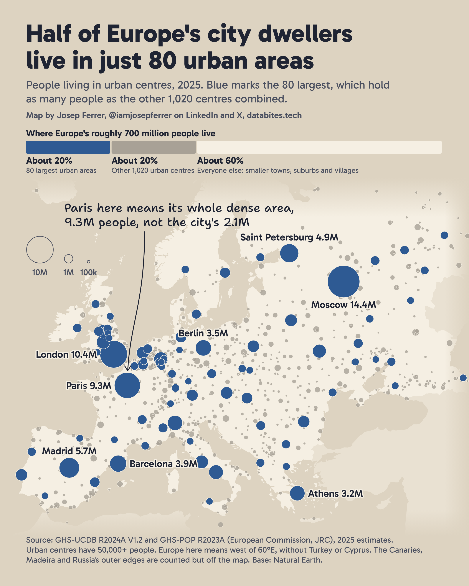
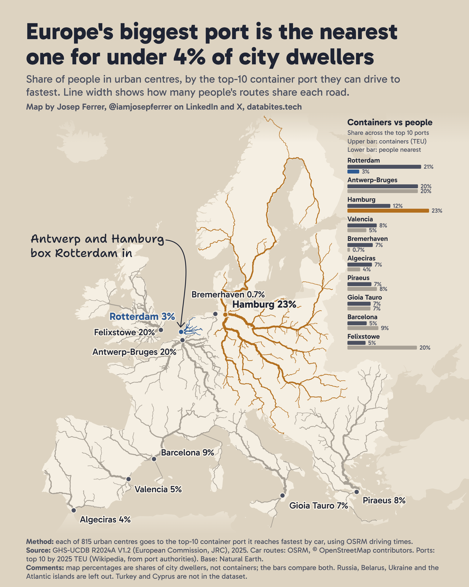
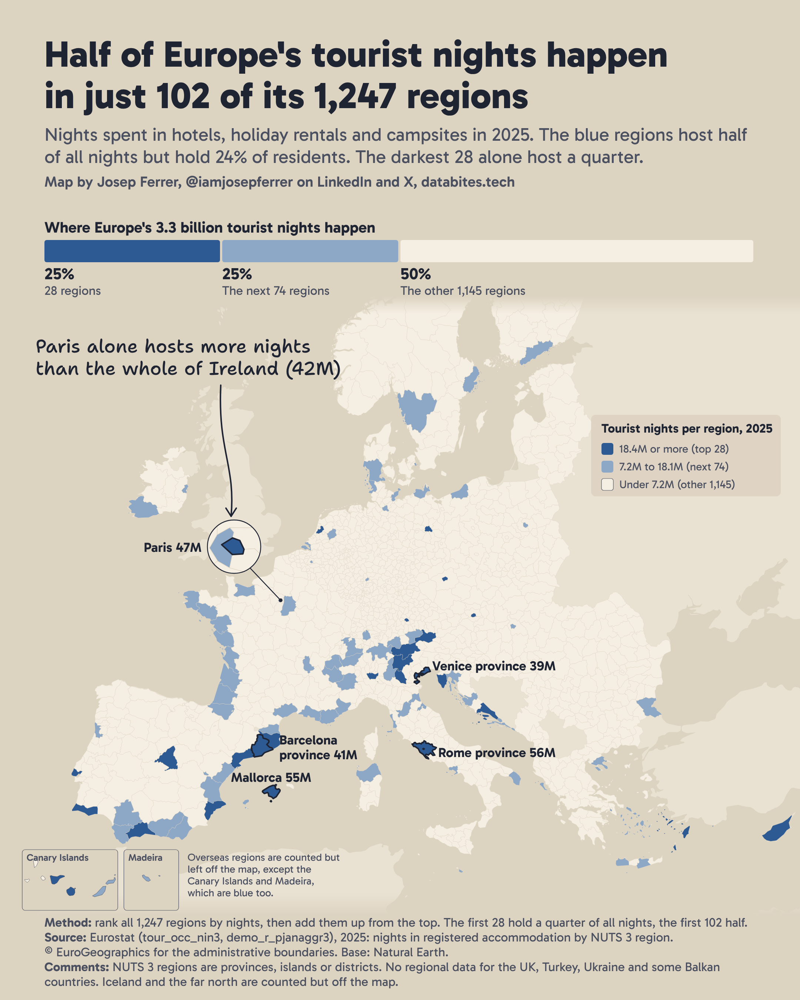
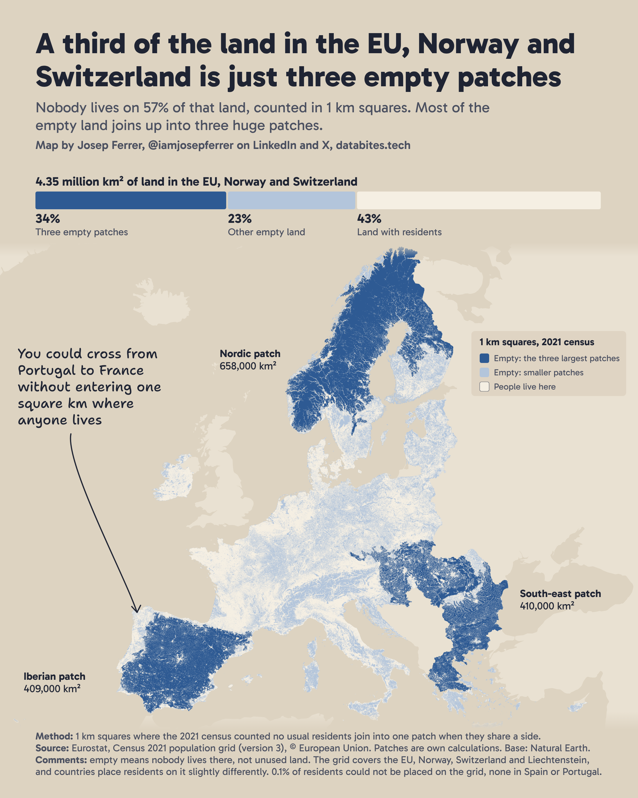
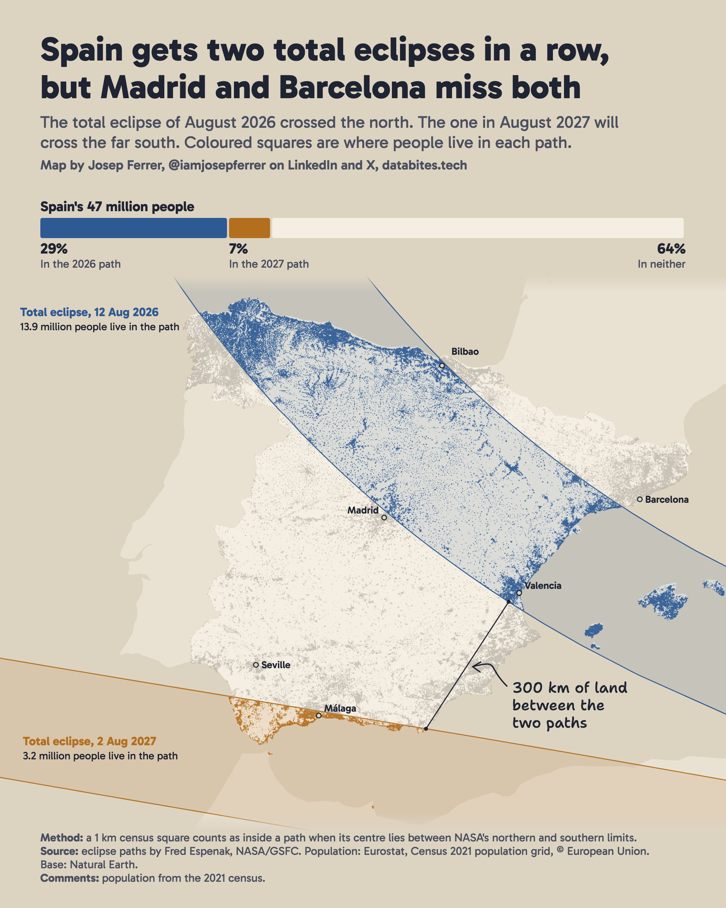
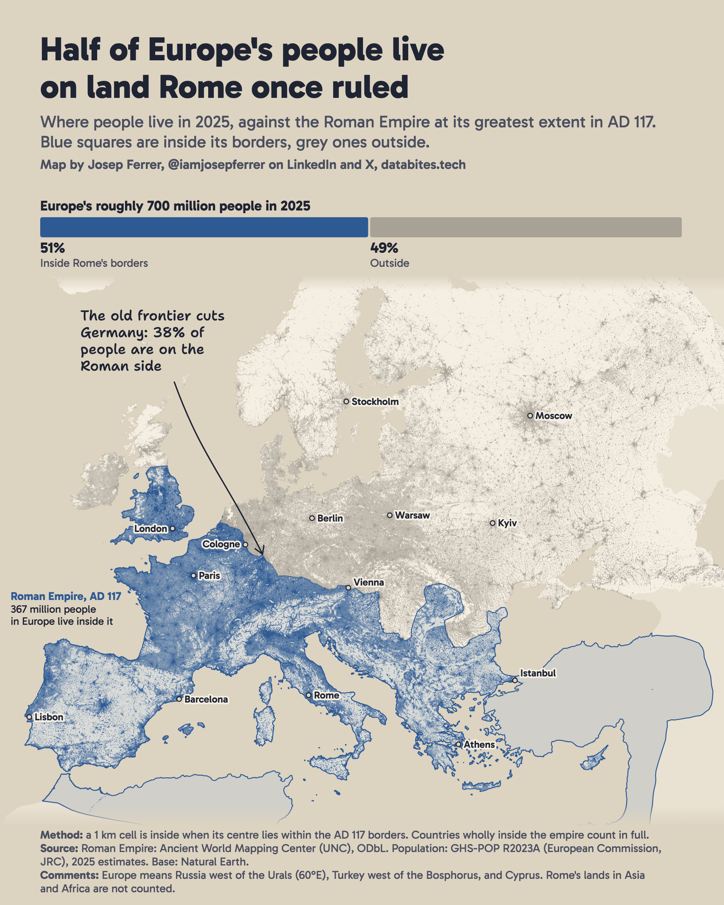
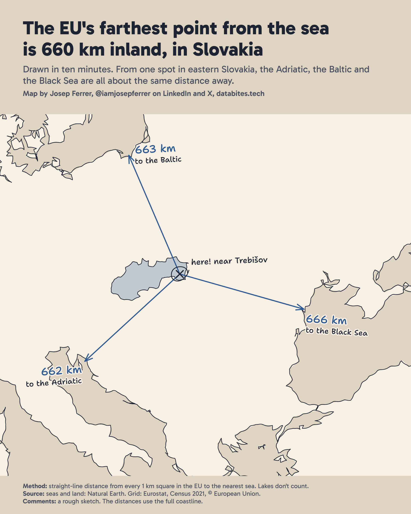
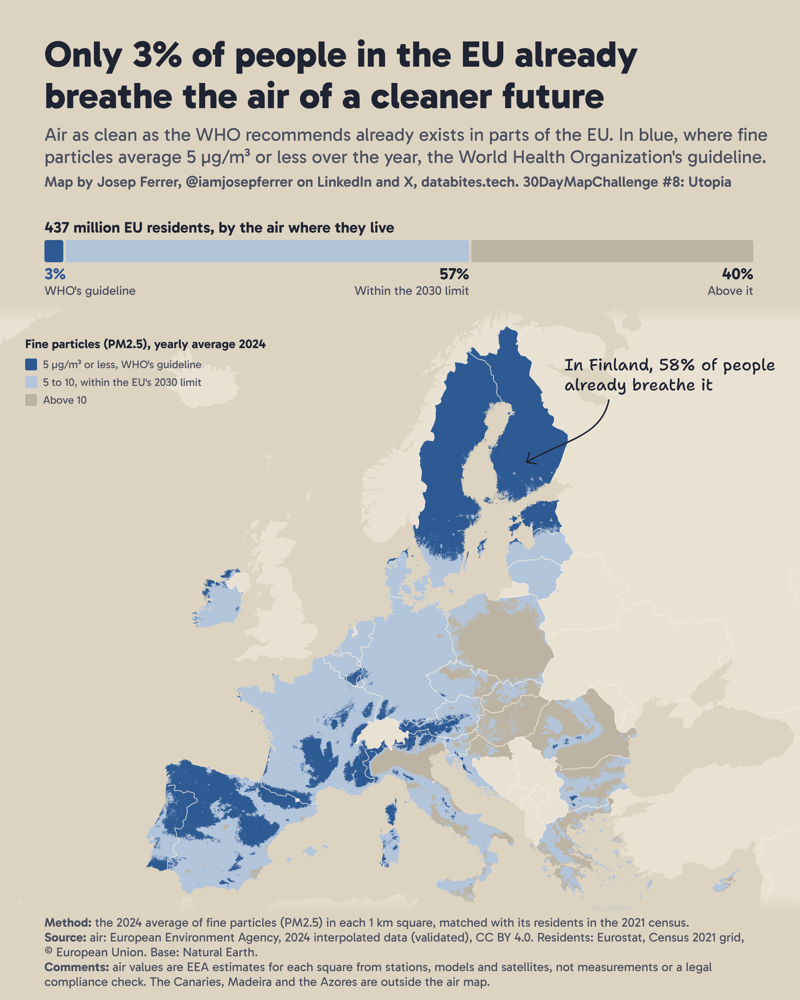
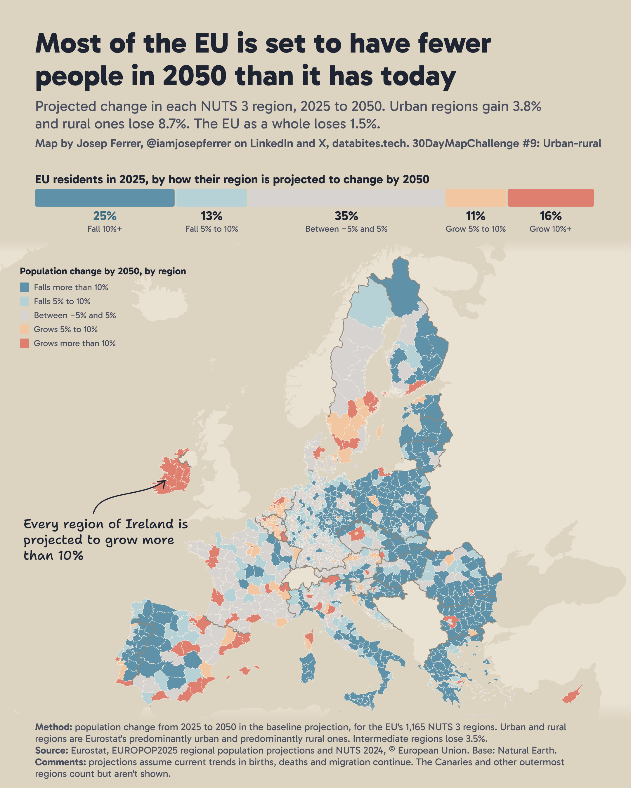

# 30DayMapChallenge 2026

One map a day about Europe, each built around a clear finding.

- [Day 1, Points: half of Europe's city dwellers live in just 80 urban areas](#day-1-points)
- [Day 2, Lines: Europe's biggest port is the nearest one for under 4% of city dwellers](#day-2-lines)
- [Day 3, Polygons: half of Europe's tourist nights happen in just 102 of its 1,247 regions](#day-3-polygons)
- [Day 4, Clusters: a third of the land in the EU, Norway and Switzerland is just three empty patches](#day-4-clusters)
- [Day 5, Senses, Sight: Spain gets two total eclipses in a row, but Madrid and Barcelona miss both](#day-5-senses-sight)
- [Day 6, Vintage: half of Europe's people live on land Rome once ruled](#day-6-vintage)
- [Day 7, 10 minute map: the EU's farthest point from the sea is 660 km inland, in Slovakia](#day-7-10-minute-map)
- [Day 8, Utopia: only 3% of people in the EU already breathe the air of a cleaner future](#day-8-utopia)
- [Day 9, Urban-rural: most of the EU is set to have fewer people in 2050 than it has today](#day-9-urban-rural)
- [Data sources and licenses](#data-sources-and-licenses)
- [How to recreate the maps](#how-to-recreate-the-maps)

**How these maps are made:** each map uses public data and is built in Python, then drawn as SVG and exported to PNG with a headless browser. I direct the analysis and the editing, and Claude helps build the code and maps. Day 10 is made entirely by prompting, as that day's theme requires.

---

## Day 1: Points



### What it shows

Europe has 1,100 urban centres with 50,000 or more people, home to 288 million people in 2025. Half of them live in the largest 80. The bar adds the wider picture: most Europeans live outside these urban centres altogether.

| Group | People in 2025 | Share of Europe |
| --- | --- | --- |
| 80 largest urban centres | 144.3 million | 20.5% |
| Other 1,020 urban centres | 144.2 million | 20.5% |
| Everyone else | 415.0 million | 59.0% |
| **Europe** | **703.5 million** | **100%** |

The map rounds these to "about 20%" and "about 60%", because the total depends on how coastal grid cells are handled. See the limitations below.

### What counts as a city here

The map uses urban centres as defined by the European Commission's Joint Research Centre (JRC): contiguous 1 km grid cells with at least 1,500 inhabitants per km² and at least 50,000 people in total. This follows where people actually live, not municipal borders. For example, Essen, Duisburg, Bochum and seven neighbouring Ruhr towns count as one urban centre of 2.7 million. In the same way, Paris on the map is its whole dense area of 9.3 million people, while the city of Paris itself has about 2.1 million.

### How it was made

1. **Load the urban centres** from GHS-UCDB R2024A V1.2, using the Europe region file and its 2025 population estimates.
2. **Limit the area** to centres west of 60°E, which removes 65 centres in Russia and leaves 1,100.
3. **Rank by population** and add up the shares. The largest 79 centres hold 49.78% of the total and the largest 80 hold 50.01%, so the blue group is 80.
4. **Calculate Europe's total** from the GHS-POP R2023A grid (30 arcsecond resolution, 2025) for the same countries west of 60°E, using Natural Earth 1:10m boundaries.
5. **Draw one circle per centre** in the ETRS89-LAEA projection (EPSG:3035), with circle area proportional to population.

### Limitations

- Turkey and Cyprus are not in this Europe dataset, so Istanbul is not on the map.
- Urban centres are split at national borders, so a cross-border urban area can appear as two centres.
- The Canaries, Madeira and centres at the far edges of Russia are counted but fall outside the map frame.
- Europe's total ranges from about 699 to 710 million depending on how coastal grid cells are treated. The published figure counts every cell that touches a 1:10m boundary. The shares barely move across that range.
- Population figures for 2025 are modelled estimates, not census counts.

**Files:** [`day01_points.py`](day01_points/day01_points.py) draws the map, [`compute_europe_population.py`](day01_points/compute_europe_population.py) calculates the total, [`europe_population.csv`](day01_points/europe_population.csv) stores it, and [`results.csv`](day01_points/results.csv) lists every centre with its rank.

---

## Day 2: Lines



### What it shows

Rotterdam handles 21% of the containers across Europe's top 10 container ports, but it is the fastest to reach for only 3.4% of the 211 million people living in the urban centres covered here. Hamburg is the fastest to reach for 23%, and Antwerp-Bruges and Felixstowe for 20% each.

| Port | Containers, 2025 (TEU) | Share of containers | Share of people nearest |
| --- | ---: | ---: | ---: |
| Rotterdam | 14,244,954 | 21.0% | 3.4% |
| Antwerp-Bruges | 13,630,000 | 20.1% | 20.1% |
| Hamburg | 8,300,000 | 12.2% | 23.2% |
| Valencia | 5,662,661 | 8.3% | 5.4% |
| Bremerhaven | 4,900,000 | 7.2% | 0.7% |
| Algeciras | 4,738,146 | 7.0% | 3.6% |
| Piraeus | 4,641,295 | 6.8% | 8.4% |
| Gioia Tauro | 4,490,566 | 6.6% | 6.6% |
| Barcelona | 3,726,624 | 5.5% | 8.8% |
| Felixstowe | 3,510,413 | 5.2% | 19.8% |

TEU means twenty-foot equivalent unit, the standard measure of container volume. Both share columns are out of the top 10 ports only.

**The main caveat:** this measures geography, not trade. Real cargo also follows rivers, rail and shipping contracts, and that gap is the point of the map. Geography alone doesn't explain why Rotterdam is the biggest.

### How it was made

1. **Choose the ports:** the top 10 European container ports by 2025 TEU, saved in [`ports.csv`](day02_lines/ports.csv).
2. **Choose the cities:** 815 urban centres from GHS-UCDB R2024A V1.2, holding 211 million people.
3. **Find each city's nearest port:** the OSRM table service returns car driving times from every city to all 10 ports, and the shortest time wins.
4. **Download the routes:** the OSRM route service returns the full road geometry from each city to its port.
5. **Check the routes:** four cities in Romania and Moldova (Bălți, Rybnitsa, Suceava and Botoșani) had routes crossing Ukraine, which is left out of the analysis, so they go to their next-nearest port with a route that avoids it. All four end up at Piraeus.
6. **Merge shared roads:** routes are snapped to a 1.5 km grid in EPSG:3035, and each road segment adds up the population of every city routed through it.
7. **Draw the lines:** width grows with the square root of population, and colour follows the port that most of those people route to.

### Limitations

- **Cars, not trucks:** driving times come from OSRM's car profile, and routes can include ferries. They ignore traffic, border checks and truck rules.
- **Left out:** Russia, Belarus and Ukraine, because road freight there is disrupted, and Iceland, the Canaries, Madeira and the Azores. Turkey and Cyprus are not in this dataset.
- **Ceuta and Melilla:** OSRM starts these two routes on the Spanish mainland instead of in the city, so their lines and times are approximate. Together they are under 0.1% of the people covered.
- **Port locations:** each port is a single approximate point at a major container terminal. Measuring from Rotterdam's Waalhaven instead of Maasvlakte raises its share from 3.4% to 3.7%, so "under 4%" holds either way.
- **Port figures:** they come from Wikipedia's list, compiled from port authorities and other published sources, not from one official dataset. Bremerhaven uses the figure for the Ports of Bremen, which also covers Bremen.
- **Road data changes:** the routes reflect OpenStreetMap as served by OSRM in November 2026, so a new download can shift the numbers slightly.

**Files:** [`day02_lines.py`](day02_lines/day02_lines.py) does everything, [`results.csv`](day02_lines/results.csv) lists each city's port, driving time and distance, and [`port_summary.csv`](day02_lines/port_summary.csv) holds the shares above.

---

## Day 3: Polygons



### What it shows

Europe's registered tourist accommodation recorded 3.28 billion nights in 2025. Half of them happened in just 102 of 1,247 regions, which are home to 24% of residents. A quarter happened in only 28 regions. Tourism pressure is not a European problem but a very local one, and the map shows where.

| Rank | Region | Nights in 2025 (million) |
| ---: | --- | ---: |
| 1 | Rome | 56.0 |
| 2 | Mallorca | 55.0 |
| 3 | Paris | 47.3 |
| 4 | Barcelona | 41.3 |
| 5 | Venice | 38.6 |
| 6 | South Tyrol (Bolzano) | 38.2 |
| 7 | Tenerife | 35.3 |
| 8 | Alicante | 34.0 |
| 9 | Madrid | 33.0 |
| 10 | Málaga | 30.6 |

Paris alone hosts more nights than the whole of Ireland (42 million), and Mallorca more than all of Belgium (46 million). Of the 28 regions that host a quarter of all nights, 9 are in Spain and 6 in Italy.

### How it was made

1. **Get nights spent** from Eurostat's `tour_occ_nin3` table for 2025: all guests in hotels, holiday and short-stay accommodation and campsites, for NUTS 3 regions.
2. **Rank the regions** by nights and add up their shares until they reach a quarter and then half of the total.
3. **Join to boundaries** from GISCO's NUTS 2024 file at 1:10 million. All 1,247 regions matched.
4. **Draw the map** in EPSG:3035 at the same scale as Day 2, with the 28 quarter regions in blue (18.4 million nights or more), the next 74 in light blue (7.2 to 18.1 million), and every other region unfilled (under 7.2 million). Five regions are outlined and labelled with their nights: Rome, Mallorca, Paris, Barcelona and Venice. The city of Paris is only a few pixels wide at this scale, so it is also shown in a magnifying lens. The Canary Islands and Madeira are in insets at the same scale, because Tenerife and Gran Canaria rank in the top 28 and Madeira 71st. No other overseas region makes the top 102: the Azores rank 273rd and France's overseas regions 445th or lower.

### Limitations

- **Registered accommodation only:** unregistered rentals, and stays with friends and family, are missing, so real tourist numbers are higher in some places.
- **All overnight guests count:** "tourists" includes domestic guests and business travellers, which is part of why Paris, Madrid and Berlin rank high.
- **Regions differ in size:** NUTS 3 regions range from German districts to large Nordic areas. A big region can reach the top half with moderate pressure, and a small one needs intense pressure, so this map shows where nights concentrate, not how crowded a place feels. The earlier version of this map, in the repo's history, showed nights per resident instead.
- **No data:** the UK, Turkey, Bosnia and Herzegovina, Kosovo, North Macedonia, Moldova, Ukraine, Belarus and Russia are not covered for 2025.
- **Svalbard left out:** Svalbard and Jan Mayen (0.2 million nights) have no boundaries in the NUTS 2024 file, so the 1,247 regions exclude them. This changes no figure on the map.
- **Not drawn:** the Azores, France's overseas regions, Madeira's uninhabited Savage Islands, Iceland and the far north are counted but not drawn.
- **Region names:** NUTS 3 regions are provinces, islands or districts, so the labels say "province" where it matters: Barcelona, Rome and Venice mean their provinces, while Paris is the city itself.

**Files:** [`day03_polygons.py`](day03_polygons/day03_polygons.py) does everything, and [`results.csv`](day03_polygons/results.csv) lists all 1,247 regions with their rank, share and group.

---

## Day 4: Clusters



### What it shows

The 2021 census counted nobody in 57% of the land in the EU, Norway and Switzerland, measured in 1 km squares. That empty land is not scattered: most of it joins up into three huge patches, which together cover 33% of all land.

| Patch | Land (km²) | Main countries |
| --- | ---: | --- |
| Nordic | 619,000 | Sweden, Norway, Finland |
| Iberian | 409,000 | Spain, Portugal, France |
| South-east | 408,000 | Romania, Bulgaria, Greece, Hungary, Slovakia |

The Iberian patch covers 72% of Spain and reaches from Portugal into France, so you could cross the peninsula without entering a single square kilometre where anyone lives. The fourth largest patch, in the Alps, is only 75,000 km².

### How it was made

1. **Load the grid:** Eurostat's Census 2021 population grid, version 3, which flags every 1 km square as populated or not, by usual residents.
2. **Join empty squares:** squares with nobody in them form one patch when they share a side.
3. **Measure each patch** by its land area, since coastal squares are only partly land.
4. **Draw the map** from the grid itself, with the three largest patches in blue.

### Limitations

- **Empty is not unused:** it means nobody lives there. The land can still be farmland, forest or mountain.
- **Countries differ:** each national statistics office places residents on the grid in its own way, which partly explains sharp edges at some borders, such as the Pyrenees.
- **Water:** lakes such as the IJsselmeer, and squares that are mostly water, count as water rather than empty land, so they neither join patches nor add to the land total.
- **Joining rule:** counting squares that only touch at a corner makes the patches bigger (the south-east one reaches about 660,000 km²), but the same three stay on top.
- **Residents not on the grid:** censuses could not place about 435,000 residents (0.1%) on a square, mostly in France, Italy, Finland and Bulgaria. Spain and Portugal have none, so the Iberian crossing holds. Every square in the three patches has zero residents.
- **Coverage:** the grid covers the EU, Norway, Switzerland and Liechtenstein, so the UK, Iceland and the Balkans outside the EU are left out. The Canary Islands and other far-off islands are counted but off the map.

**Files:** [`day04_clusters.py`](day04_clusters/day04_clusters.py) does everything, and [`results.csv`](day04_clusters/results.csv) lists the three patches.

---

## Day 5: Senses, Sight



### What it shows

The total eclipse of 12 August 2026 crossed northern Spain, and the next total eclipse, on 2 August 2027, will cross the far south. Nobody in Spain lives inside both paths. Over land, the two paths never come closer than 300 km.

| Eclipse | People in Spain in the path | Share of Spain's 47.4 million |
| --- | ---: | ---: |
| Total, 12 August 2026 | 13.9 million | 29% |
| Total, 2 August 2027 | 3.2 million | 7% |

The 2026 path covered cities such as A Coruña, Oviedo, Bilbao, Valladolid, Zaragoza, Valencia and Palma, but not Madrid or Barcelona. The 2027 path covers Cádiz, Málaga, Ceuta and Melilla, but not Seville. These match the city lists of Spain's Instituto Geográfico Nacional.

### How it was made

1. **Get the paths:** the northern and southern limits of each eclipse from NASA's eclipse site (Fred Espenak, GSFC), read from its interactive map pages. They list more points than the printed tables, including the end of the 2026 path at sunset over the Balearics.
2. **Count the people:** Eurostat's Census 2021 population grid, the same file as Day 4. A 1 km square counts as inside a path when its centre lies between the two limits.
3. **Measure the gap** between the closest points of the two paths over mainland Spain.
4. **Frame the map** so both ends of the 2026 path run off its edges. The path really ends at sunset just east of the Balearics.
5. **Draw the map:** every populated square in Spain, coloured blue or orange when it sits in a total eclipse path. Portugal is left grey because fewer than 20 of its residents live in either path.

### Limitations

- **Edges:** a square counts by its centre, so totals are rounded to 0.1 million. The path widths match NASA's tables (about 290 km over Spain in 2026, 240 km in 2027).
- **Population is from 2021,** and it counts residents, not the visitors who travelled to see the eclipse.
- **Seeing it:** being in the path is not the same as seeing totality. Clouds, and the low sun in 2026, decide that.
- **Coverage:** the grid covers the EU, so people in Morocco under the 2027 path are not counted.

**Files:** [`day05_sight.py`](day05_sight/day05_sight.py) does everything, and [`results.csv`](day05_sight/results.csv) lists the people in each path.

---

## Day 6: Vintage



### What it shows

The Roman Empire reached its greatest extent in AD 117. Laying those borders over today's population, 366.9 million of Europe's 715.7 million people (51%) live on land Rome once ruled.

| Country | People in 2025 | Share inside the AD 117 borders |
| --- | ---: | ---: |
| France | 64.2 million | 100% |
| Italy | 57.7 million | 100% |
| Turkey, European part | 10.7 million | 100% |
| Spain | 46.5 million | 96% |
| United Kingdom | 67.4 million | 87% |
| Netherlands | 17.6 million | 47% |
| Germany | 83.2 million | 38% |
| Poland | 39.7 million | 0% |
| Russia, west of 60°E | 110.3 million | 0% |

Spain and Portugal are below 100% only because the Canaries, Madeira and the Azores were never Roman. Every country is in [`results.csv`](day06_vintage/results.csv).

### How it was made

1. **Get the borders:** the Roman Empire's AD 117 extent from the Ancient World Mapping Center, derived from the Barrington Atlas.
2. **Check the borders** against 36 frontier towns. The main frontiers hold: in Britain the border runs from the Tyne to the Solway, so Edinburgh is outside; on the Rhine, Cologne is inside and Düsseldorf's east bank outside; on the German limes, Frankfurt and Stuttgart are inside and Giessen and Nuremberg outside; on the Danube, central Vienna is inside and its north bank outside; and Dacia covers Transylvania and Oltenia.
3. **Fix three problems:** the simplified coastline left out coastal cells and small islands such as the Balearics and Malta, so countries wholly inside the empire count in full. The Dutch frontier follows the Old Rhine through Leiden and Utrecht, so Amsterdam is outside. Buda, the site of the legionary fortress of Aquincum, is inside.
4. **Count the people:** GHS-POP's 2025 estimates at about 1 km, for geographic Europe: the same countries as Day 1, west of 60°E, plus Cyprus and Turkey west of the Bosphorus. A cell counts as inside when its centre lies within the borders.
5. **Check the population:** for the EU, Norway and Switzerland, GHS-POP gives 61.2% inside and Eurostat's Census 2021 grid gives 61.7%.
6. **Check the totals:** for the 33 countries with Eurostat 2025 figures, GHS-POP's total is 98% of the official one, although single countries differ (Norway -17%, Albania +19%). Assuming only 30 million people in Ukraine gives 51.7%.
7. **Draw the map:** people in small blocks, blue inside the empire and grey outside, darker where more people live. Blocks with fewer than 25 people are left out of the drawing, because GHS-POP spreads tiny modelled values over empty land. They still count in the totals. Asian Turkey and Russia east of 60°E are drawn as land without people.

### Limitations

- **Ancient frontiers are approximate.** Places close to the line can fall on the wrong side. Muntenia, around Bucharest, and the Banat, around Timișoara, are outside: Trajan held Muntenia only until Hadrian gave it up in 117 and 118, and the Banat's status is debated. Counting both would give 52.3%.
- **Greatest extent is a single moment.** Rome did not rule all of this land for long. Dacia, in today's Romania, was held for about 170 years.
- **Scope drives the number.** Russia, Belarus and Ukraine add 156 million people, almost all outside the empire. Without them, the share is about 66%.
- **Population:** GHS-POP is a modelled 2025 estimate, projected from census data and spread across built-up areas. It is not a census count and has no single census year. Day 4 needs a real count of empty squares, so it uses Eurostat's Census 2021 grid instead.
- **Who is left out:** Asian Turkey, the Caucasus, western Kazakhstan and Rome's lands in Africa and Asia are not counted.

**Files:** [`day06_vintage.py`](day06_vintage/day06_vintage.py) does everything, and [`results.csv`](day06_vintage/results.csv) lists every country.

---

## Day 7: 10 minute map



### What it shows

The theme asks for a map made in no more than ten minutes, so this one is a rough sketch: just the coastline, Slovakia and three lines. The point in the EU farthest from any sea lies near Trebišov, in eastern Slovakia. From there, the Adriatic is 662 km away, the Baltic 663 km and the Black Sea 666 km.

### How it was made

1. **Map the sea:** Natural Earth's ocean layer at 1:10 million, which includes the Baltic, the Mediterranean and the Black Sea but not lakes such as the Caspian.
2. **Measure the distance** from every 1 km square of the EU, on Eurostat's Census 2021 grid, to the nearest sea, in EPSG:3035.
3. **Check the farthest point:** measure its true distance to each of the three nearest seas from a projection centred on that point.
4. **Sketch the map:** a simplified coastline with a slight wobble, Slovakia, and three straight lines to the seas.

### Limitations

- **Straight lines:** distances are as the crow flies, not by road.
- **Coastline detail:** at 1:10 million, small bays and lagoons are simplified, which can shift distances by a kilometre or two.
- **The sketch:** the coastline is simplified and small islands are left out of the drawing. The distances use the full coastline.
- **Coverage:** the EU's 27 countries only.

**Files:** [`day07_ten_minute.py`](day07_ten_minute/day07_ten_minute.py) does everything, and [`results.csv`](day07_ten_minute/results.csv) holds the point and the three distances.

---

## Day 8: Utopia



### What it shows

Air as clean as the World Health Organization recommends already exists in parts of the EU. In 2024, 3% of the EU's residents (13 million people) lived where fine particles (PM2.5) averaged 5 µg/m³ or less over the year, the WHO's guideline. Another 57% lived where they averaged between 5 and 10 µg/m³, within the EU's new limit for 2030, and 40% lived above 10.

| Country | Residents with WHO-level air | Residents within the 2030 limit |
| --- | ---: | ---: |
| Finland | 58% | 100% |
| Estonia | 49% | 100% |
| Sweden | 42% | 100% |
| Portugal | 12% | 91% |
| Spain | 4% | 63% |
| France | 2% | 99% |
| Germany | 0.2% | 95% |
| Italy | 0.3% | 18% |
| Poland | 0% | 3% |

Clean air is mostly where few people live: the north, the mountains and inland Iberia. Every country is in [`by_country.csv`](day08_utopia/by_country.csv).

### How it was made

1. **Get the air:** the European Environment Agency's map of PM2.5 for 2024 (validated data, June 2026), an annual average for every 1 km square. Squares the file marks as missing (-99) are skipped.
2. **Get the residents:** Eurostat's Census 2021 population grid, on the same 1 km squares.
3. **Match them:** each square's residents get that square's PM2.5 value, and EU countries come from Eurostat's NUTS 2021 borders.
4. **Count the residents** in three groups: within WHO's guideline (5 µg/m³), within the EU's 2030 limit (10 µg/m³), and above it.

### Limitations

- **Modelled air:** the EEA combines monitoring stations, a chemical transport model and other data. Values are estimates for each square, not measurements.
- **Different years:** the air is from 2024 and the residents from the 2021 census.
- **Annual averages:** a square within the guideline can still have bad days.
- **Close to the line:** many squares sit near 5 µg/m³, so the share moves with the threshold. Counting squares up to 5.5 µg/m³ gives 4.7%, and up to 4.5 gives 1.7%.
- **Not a compliance check:** the EEA describes these maps as European-scale estimates, not for checking formal compliance with limit values. The 2030 limit is used here only as a reference level.
- **Only fine particles:** clean PM2.5 does not mean clean air in every sense. Other pollutants, such as nitrogen dioxide and ozone, are not mapped.
- **Coverage:** the Canaries, Madeira and the Azores (2.6 million residents) are outside the air map and not counted.

**Files:** [`day08_utopia.py`](day08_utopia/day08_utopia.py) does everything, [`results.csv`](day08_utopia/results.csv) holds the EU shares, and [`by_country.csv`](day08_utopia/by_country.csv) the shares for each country.

---

## Day 9: Urban-rural



### What it shows

Eurostat's newest regional projections (EUROPOP2025, published in October 2026) expect 72% of the EU's 1,165 NUTS 3 regions to have fewer people in 2050 than in 2025. Those regions cover 70% of the EU's land and are home to 57% of its residents. The EU as a whole loses only 1.5%, from 451.8 to 445.0 million.

Where people live decides which way a region goes:

| Region type | Regions | Change, 2025 to 2050 |
| --- | ---: | ---: |
| Predominantly urban | 261 | +3.8% |
| Intermediate | 517 | −3.5% |
| Predominantly rural | 387 | −8.7% |

Urban regions do better than rural ones in 22 of the 23 countries that have both. Belgium is the exception, with both close to +7%.

By residents in 2025, 25% live in regions set to lose more than 10% of their people, 13% in regions losing 5% to 10%, 35% in regions that change less than 5% either way, 11% in regions gaining 5% to 10%, and 16% in regions gaining more than 10%. Every region of Ireland is projected to grow more than 10%. The steepest falls are in Smolyan in Bulgaria (−44%), Kirde-Eesti in north-east Estonia (−43%) and Dobrich in Bulgaria (−41%). Every region is in [`projection_by_region.csv`](day09_urban_rural/projection_by_region.csv).

### How it was made

1. **Get the projection:** Eurostat's `proj_25rp5`, the baseline projection of the total population on 1 January 2025 and 2050, for every NUTS 3 region.
2. **Get the regions:** Eurostat's NUTS 2024 boundaries, which also carry each region's urban-rural type.
3. **Group the regions** in five bands by their change from 2025 to 2050, and count the residents in each band.
4. **Compare region types:** add up 2025 and 2050 residents of urban, intermediate and rural regions.

The urban-rural type comes from Eurostat's 1 km population grid. Squares outside urban clusters (groups of squares with at least 300 people per km² and 5,000 people in total) count as rural. A region is predominantly rural if more than 50% of its people live in rural squares, intermediate between 20% and 50%, and predominantly urban below 20%, with adjustments for regions with large cities and for very small regions.

### Limitations

- **A projection, not a forecast:** the baseline assumes current trends in births, deaths and migration continue. Eurostat's own tests move the share of shrinking regions from 51% (higher migration) to 85% (lower migration), and to 97% with no migration at all. In every test, most regions shrink.
- **Starting point:** the projection starts from its own estimate for 2025 (451.8 million), slightly above Eurostat's count for 1 January 2025 (450.6 million).
- **Whole regions:** each region gets one colour. A shrinking rural region can hold a growing town, and the urban-rural type describes the region as a whole.
- **Different region sizes:** NUTS 3 regions range from small German districts to large Swedish and Finnish counties, so big, thinly populated regions take up much of the map. The bar shows the same result by residents.
- **Coverage:** the Canaries, Madeira, the Azores and the French overseas regions are counted but not drawn.

**Files:** [`day09_urban_rural.py`](day09_urban_rural/day09_urban_rural.py) does everything, and [`projection_by_region.csv`](day09_urban_rural/projection_by_region.csv) holds every region's type, residents and change.

---

## Data sources and licenses

| Dataset | Used for | Where it comes from | License |
| --- | --- | --- | --- |
| [GHS-UCDB R2024A V1.2](https://human-settlement.emergency.copernicus.eu/ghs_ucdb_2024.php) | Urban centres and population (Days 1, 2) | Downloaded from the JRC's open data site | CC BY 4.0 |
| [GHS-POP R2023A](https://human-settlement.emergency.copernicus.eu/download.php) | Europe's total population (Day 1), people by location (Day 6) | Downloaded from the JRC's open data site | CC BY 4.0 |
| [Natural Earth](https://www.naturalearthdata.com/) | Land, seas and country boundaries (Days 1 to 9) | GitHub mirror of Natural Earth | Public domain |
| [OSRM](https://project-osrm.org/) on [OpenStreetMap](https://www.openstreetmap.org/copyright) | Driving times and routes (Day 2) | OSRM's free demo server | Data: ODbL, © OpenStreetMap contributors |
| [List of busiest ports in Europe](https://en.wikipedia.org/wiki/List_of_busiest_ports_in_Europe) | Top 10 ports and TEU (Day 2) | Wikipedia, read in November 2026 | CC BY-SA |
| [Eurostat](https://ec.europa.eu/eurostat/data/database) `tour_occ_nin3`, `demo_r_pjanaggr3` | Nights spent and residents (Day 3) | Eurostat's statistics API | Free reuse with credit to Eurostat |
| [GISCO NUTS 2024](https://ec.europa.eu/eurostat/web/gisco/geodata/statistical-units/territorial-units-statistics) | Regional boundaries (Day 3), regions and their urban-rural type (Day 9) | Eurostat's GISCO service | © EuroGeographics for the administrative boundaries. Free for non-commercial use |
| [Eurostat Census 2021 population grid](https://ec.europa.eu/eurostat/web/gisco/geodata/population-distribution/population-grids) | 1 km population grid (Days 4, 5, 7, 8) | Eurostat's GISCO service | © European Union, free reuse with credit |
| [NASA eclipse paths](https://eclipse.gsfc.nasa.gov/solar.html) | Paths of the 2026 and 2027 total eclipses (Day 5) | NASA's eclipse site, by Fred Espenak (GSFC) | Free to use with credit to NASA |
| [AWMC geodata](https://github.com/AWMC/geodata) | Roman Empire at its greatest extent, AD 117 (Day 6) | GitHub, Ancient World Mapping Center, University of North Carolina | ODbL |
| [EEA interpolated air quality data, PM2.5 2024](https://sdi.eea.europa.eu/catalogue/srv/api/records/c3db03e4-82e9-4a40-acb1-a5bd15f11f8c) | Annual PM2.5 on a 1 km grid (Day 8) | European Environment Agency | CC BY 4.0, © EEA |
| [GISCO NUTS 2021](https://ec.europa.eu/eurostat/web/gisco/geodata/statistical-units/territorial-units-statistics) | EU country borders (Day 8) | Eurostat's GISCO service | © EuroGeographics for the administrative boundaries |
| [Eurostat EUROPOP2025](https://ec.europa.eu/eurostat/databrowser/view/proj_25rp5/default/table) `proj_25rp5` | Population projections by NUTS 3 region, 2025 and 2050 (Day 9) | Eurostat's statistics API | Free reuse with credit to Eurostat |

**Citations**

- Mari Rivero, I. et al. (2024). GHS-UCDB R2024A, GHS Urban Centre Database 2025. European Commission, JRC. doi: [10.2905/1a338be6-7eaf-480c-9664-3a8ade88cbcd](https://doi.org/10.2905/1a338be6-7eaf-480c-9664-3a8ade88cbcd)
- Schiavina, M., Freire, S., Carioli, A., MacManus, K. (2023). GHS-POP R2023A, GHS population grid multitemporal (1975-2030). European Commission, JRC. doi: [10.2905/2FF68A52-5B5B-4A22-8F40-C41DA8332CFE](https://doi.org/10.2905/2FF68A52-5B5B-4A22-8F40-C41DA8332CFE)

The maps use the Gabarito and Shantell Sans fonts, both under the SIL Open Font License.

## How to recreate the maps

Follow the setup in the [main README](../README.md), then run:

```bash
python 2026/day01_points/day01_points.py
python 2026/day02_lines/day02_lines.py
python 2026/day03_polygons/day03_polygons.py
python 2026/day04_clusters/day04_clusters.py
python 2026/day05_sight/day05_sight.py
python 2026/day06_vintage/day06_vintage.py
python 2026/day07_ten_minute/day07_ten_minute.py
python 2026/day08_utopia/day08_utopia.py
python 2026/day09_urban_rural/day09_urban_rural.py
```

- **Day 1** takes about a minute and downloads about 50 MB. Recalculating Europe's total with `compute_europe_population.py` is optional and downloads about 475 MB.
- **Day 2** sends about 830 requests to the OSRM demo server the first time, at no more than one per second, so it takes around 25 minutes. Results are saved in `cache/`, so you can stop and resume it. The demo server is for reasonable, non-commercial use, so client work needs its own OSRM instance.
- **Day 4** downloads the 566 MB census grid once, then takes about a minute.
- **Day 5** uses the same census grid as Day 4 and three small NASA pages, and takes about a minute.
- **Day 6** downloads the 461 MB GHS-POP grid once, then takes about a minute.
- **Day 7** uses the same census grid as Day 4 and Natural Earth's ocean layer (10 MB), and takes about a minute.
- **Day 8** uses the same census grid as Day 4 and downloads the EEA's 78 MB air quality map once, then takes about a minute.
- **Day 9** downloads Eurostat's projections and the NUTS 2024 regions (25 MB) once, then takes about ten seconds.

## License

The code is MIT licensed. The maps are CC BY 4.0. Each dataset keeps the license listed above, and anything derived from OpenStreetMap stays under ODbL.
